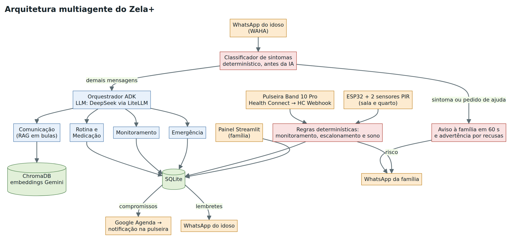
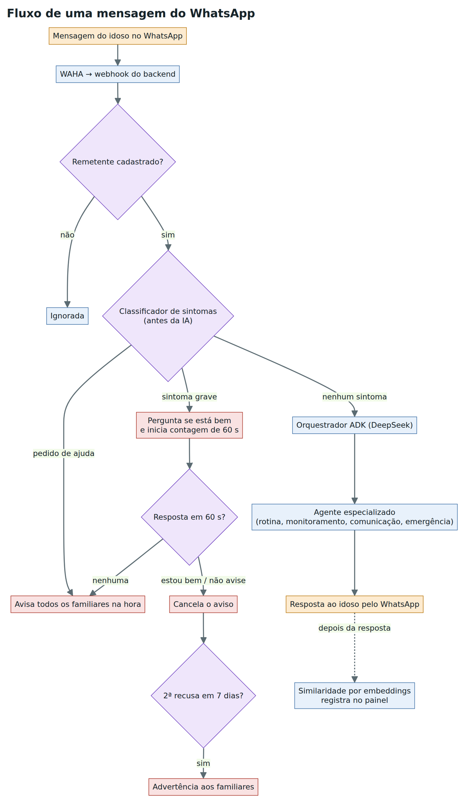
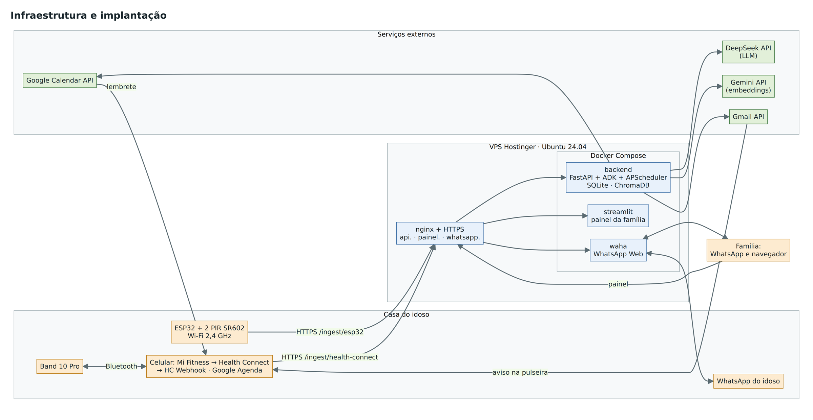
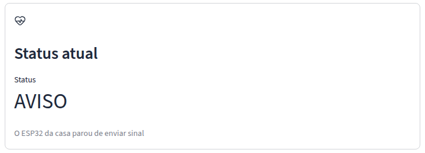
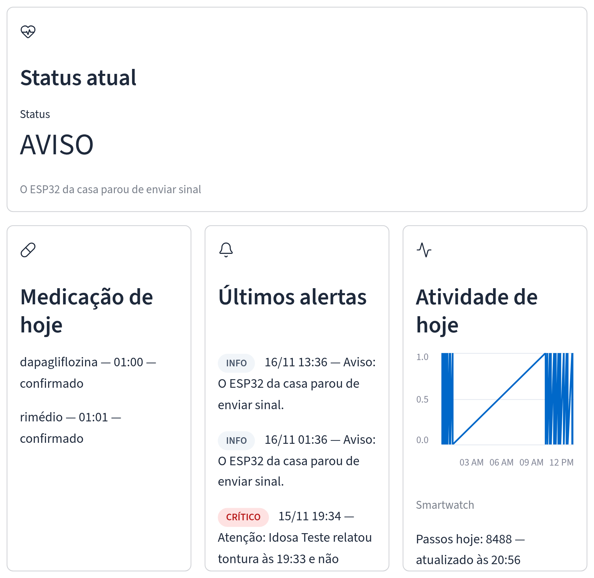
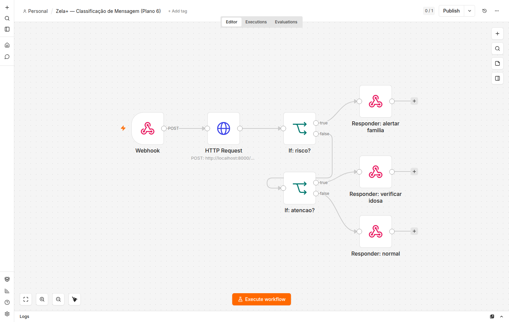

# Zela+ — Agente de IA de Apoio ao Idoso que Mora Sozinho

Trabalho final da pós-graduação em Agentes de IA.

## O problema

Idosos que moram sozinhos esquecem remédios e compromissos, e uma queda ou
um mal-estar pode passar horas sem que ninguém perceba. A família, longe,
não tem visibilidade do dia a dia, e ligar toda hora cansa os dois lados.

## A solução

O Zela+ é um sistema multiagente (Google ADK) que conversa com o idoso pelo
WhatsApp, acompanha a rotina e os sinais da casa e mantém a família
informada:

- **Lembretes de remédio** como enquete no WhatsApp ("✅ Tomei" / "⏰ Ainda
  não"), respondida com um toque, e também como notificação na pulseira.
- **Lembretes de compromissos** pelo WhatsApp e pelo Google Agenda, que
  aparece na pulseira.
- **Aviso à família em 60 segundos** quando o idoso relata um sintoma grave
  e não responde, e na hora quando pede ajuda.
- **Monitoramento** com uma pulseira Xiaomi Smart Band 10 Pro (passos, sono
  e batimentos) e um ESP32 com 2 sensores de presença (sala e quarto), com
  uma escada de escalonamento que pode chegar a simular o contato com um
  serviço de emergência.
- **Respostas sobre medicamentos** com RAG sobre bulas.
- **Painel Streamlit** para a família, com login, histórico e modo noturno.

Nenhuma decisão de emergência depende de um LLM: o classificador de
sintomas, as regras de monitoramento e a escada de escalonamento são
código determinístico e testado. A IA conversa, consulta e explica.

O sistema roda em produção em uma VPS, com Docker Compose e HTTPS.

## Arquitetura



| Agente | Responsabilidade |
|---|---|
| Orquestrador | Direciona cada mensagem ao agente especializado |
| Rotina e Medicação | Lembretes, confirmação de doses e compromissos |
| Monitoramento | Relata o status calculado pelas regras (normal, aviso, atenção, risco) |
| Comunicação | Conversa com o idoso e a família e consulta as bulas (RAG) |
| Emergência | Relata alertas e ocorrências registradas |





## Tecnologias

| Área | Tecnologia |
|---|---|
| Agentes e orquestração | Google ADK |
| LLM da conversa | DeepSeek (via LiteLLM) ou Gemini |
| Validação de dados | Pydantic |
| Embeddings e RAG | Gemini (`gemini-embedding-2`) e ChromaDB |
| API e agendamento | FastAPI e APScheduler |
| Banco de dados | SQLite |
| WhatsApp | WAHA (WhatsApp HTTP API, self-hosted) |
| Painel | Streamlit |
| Fluxo visual | n8n (no lugar do Langflow do enunciado) |
| Sensores | ESP32 com 2 PIR SR602; Smart Band 10 Pro via Health Connect |
| Notificações na pulseira | Google Agenda e Gmail |
| Implantação | Docker Compose, nginx e Let's Encrypt |
| Testes | pytest |

## Estrutura do repositório

```
zela/
  models/          contratos de dados Pydantic
  domain/          regras de negócio puras (rotina, monitoramento, sintomas, escalonamento)
  agents/          agentes ADK (orquestrador e 4 especializados)
  storage/         repositórios SQLite
  embeddings/      cliente de embeddings, classificador por similaridade e vector store
  conhecimento/    bulas usadas pelo RAG
  integrations/    clientes do WAHA, Google Agenda e Gmail
  api/             FastAPI: webhook do WhatsApp, ingestão de sensores, scheduler
  streamlit_app/   painel da família
firmware/          firmware do ESP32 (Arduino)
docs/              relatório (imagens e diagramas), n8n, hardware, deploy, testes e pitch
scripts/           utilitários (token do Google, teste do Gmail, importação de bulas)
tests/             suíte automatizada
```

## Instalação

Requer Python 3.11 ou superior.

```bash
git clone https://github.com/augustolnb/zela-mais.git
cd zela-mais
python -m venv .venv
source .venv/bin/activate
pip install -e ".[dev,deepseek]"
cp .env.example .env    # preencha as chaves
```

O extra `deepseek` instala o LiteLLM. Sem ele, o projeto roda só com o
Gemini.

### Variáveis de ambiente

| Variável | Uso |
|---|---|
| `GOOGLE_API_KEY` | Gemini: embeddings sempre, e a conversa quando o provedor é `gemini` |
| `ZELA_LLM_PROVEDOR` | `gemini` (padrão) ou `deepseek` |
| `DEEPSEEK_API_KEY` | Obrigatória com `ZELA_LLM_PROVEDOR=deepseek` |
| `WAHA_API_KEY` | Chave da API do WAHA (o backend a recebe como `ZELA_WAHA_API_KEY`) |
| `ZELA_INGESTAO_TOKEN` | Token do header `X-Api-Key` dos endpoints de ingestão, classificação e webhook. Obrigatório em servidor público |
| `ZELA_GOOGLE_CALENDAR_*` | Credencial OAuth, `refresh_token` e ID da agenda (opcional) |
| `ZELA_GMAIL_PULSEIRA_EMAIL`, `ZELA_GMAIL_MODO` | Aviso pelo Gmail na pulseira (opcional) |
| `ZELA_DB_PATH` | Caminho do `zela.db`; backend e painel precisam usar o mesmo |

## Executando

### 1. WhatsApp (WAHA)

```bash
docker compose up -d waha
```

Abra `http://localhost:3000`, escaneie o QR code com o número que vai
representar o Zela+ e configure o webhook da sessão para
`http://<host-do-backend>:8000/webhook/whatsapp` com os eventos `message`,
`poll.vote` e `poll.vote.failed`. Se `ZELA_INGESTAO_TOKEN` estiver
definido, adicione o header `X-Api-Key` com o mesmo valor no webhook.

### 2. Backend

```bash
uvicorn zela.api.main:app --reload --host 0.0.0.0 --port 8000
```

O backend recebe as mensagens, envia lembretes, aplica as regras de
monitoramento e sincroniza o índice do RAG.

### 3. Cadastro do idoso

O perfil do idoso e dos familiares é cadastrado uma vez, por script. O
`idoso_id` usado em todo o sistema é `"idosa-1"`:

```python
from datetime import date
from zela.models.perfil import ContatoFamiliar, PerfilIdoso
from zela.storage.db import conectar
from zela.storage.perfil import salvar_perfil

conn = conectar("zela.db")
salvar_perfil(conn, PerfilIdoso(
    nome="Maria da Silva",
    telefone="+5511900000000",            # formato E.164
    data_nascimento=date(1945, 3, 12),
    contatos_familiares=[ContatoFamiliar(nome="João", telefone="+5511987654321")],
), idoso_id="idosa-1")
```

Se o WhatsApp do idoso chegar como LID (`<número>@lid`) em vez do telefone,
cadastre esse identificador no campo `lid_whatsapp` do perfil. Medicamentos
e compromissos são cadastrados pelo painel.

### 4. Painel da família

```bash
python -m zela.streamlit_app.usuarios criar familia    # pede a senha duas vezes
streamlit run zela/streamlit_app/app.py
```

Abra `http://localhost:8501` e entre com usuário e senha. Outros comandos de
usuário: `listar`, `senha <usuário>` e `remover <usuário>`.

O painel mostra o status atual, a medicação do dia, os últimos alertas e a
atividade de hoje, com formulários de medicamentos e compromissos. A aba
**Histórico** reúne avisos, compromissos e doses, com filtros por dia,
busca e tipo. O interruptor **Modo noturno** alterna entre o tema claro e o
escuro.





### 5. Testando os agentes sem WhatsApp

```bash
adk run zela/agents
```

Em produção, cada mensagem chega aos agentes com uma linha de contexto.
No `adk run`, digite-a antes da pergunta para testar as ferramentas:
`[contexto do sistema: idoso_id=idosa-1; agora=2026-01-01T08:00:00] já tomei o remédio`.

## Testes

```bash
pytest -q
```

A suíte cobre modelos, domínio, armazenamento, API, scheduler, embeddings,
agentes ADK e painel, sem chamadas reais a LLM ou rede. A estratégia de
testes está em `docs/testes/estrategia-e-resultados.md`.

## Funcionalidades em detalhe

### Lembrete de remédio com enquete

O lembrete chega como enquete de escolha única:

> Hora de tomar dapagliflozina (1.0 comprimido). Já tomou?
> ◯ ✅ Tomei
> ◯ ⏰ Ainda não

- **✅ Tomei** registra a dose sem passar pela IA (como atrasada depois de
  30 min do horário). Votar de novo não duplica.
- **⏰ Ainda não** reenvia o lembrete 30 min depois, no mesmo dia e só se a
  dose não foi confirmada.
- Escrever "tomei" continua funcionando. Se a enquete falhar, sai o
  lembrete em texto.

Botões só existem na API oficial da Meta; no WAHA (WhatsApp Web), a enquete
é a alternativa.

### Aviso à família após relato de sintomas

Toda mensagem do idoso passa antes por um classificador determinístico de
sintomas. Um sintoma grave faz o bot perguntar se está tudo bem; sem
resposta em 60 segundos, todos os familiares são avisados. Pedido de ajuda
avisa na hora. "Estou bem" ou "não avise" cancelam o aviso, e duas recusas
em 7 dias geram uma advertência à família.

### Regras de monitoramento

Avaliadas a cada 15 min; vale a condição mais grave:

| Status | Condição |
|---|---|
| RISCO | 8 h ou mais sem movimento, com o ESP32 enviando sinal de vida |
| RISCO | ESP32 sem sinal há 15 min **e** pulseira sem dados há 6 h |
| ATENÇÃO | Frequência cardíaca fora da faixa plausível |
| AVISO | Só uma das fontes sem dados: mensagem à família, sem escada |
| NORMAL | Nenhuma das condições acima |

Em RISCO, a escada pergunta ao idoso, avisa a família depois de 10 min sem
resposta e simula o contato de emergência 15 min depois. O sono da noite
30% acima ou abaixo da média gera um aviso de tendência no resumo da manhã.

### Sensores

**ESP32:** 2 PIR SR602 (sala no GPIO 13, quarto no GPIO 14), alimentados em
3,3 V. Copie `firmware/zela_presenca/config.h.example` para `config.h`,
preencha Wi-Fi, URL de ingestão e token, e grave
`firmware/zela_presenca/zela_presenca.ino` pelo Arduino IDE (placa "ESP32
Dev Module"). Ligações e materiais em `docs/hardware/automacao_esp32.md`.

**Pulseira:** Smart Band 10 Pro → Mi Fitness → Health Connect →
[HC Webhook](https://github.com/mcnaveen/health-connect-webhook) (instalado
de graça pelo Obtainium). No HC Webhook, configure a URL
`https://<backend>/ingest/health-connect`, formato JSON e o header
`x-api-key` com o valor de `ZELA_INGESTAO_TOKEN`.

### Google Agenda e Gmail na pulseira

Os compromissos cadastrados no painel são criados na agenda de uma conta
Google dedicada, e o lembrete da agenda aparece na pulseira. O lembrete de
remédio e a pergunta "você está bem?" também chegam como e-mail, que o Mi
Fitness espelha na pulseira.

1. No Google Cloud, ative a Google Calendar API e a Gmail API, crie uma
   credencial OAuth do tipo **Desktop app** e publique o app em
   **produção**. Em modo de teste, o `refresh_token` expira em poucos dias.
2. Gere o `refresh_token` com `python scripts/obter_refresh_token_google.py`.
3. Preencha as variáveis `ZELA_GOOGLE_CALENDAR_*` e, para o Gmail,
   `ZELA_GMAIL_PULSEIRA_EMAIL`. Use `python scripts/testar_gmail_pulseira.py`
   para escolher o `ZELA_GMAIL_MODO` (`insert` ou `send`).
4. No celular do idoso, adicione a conta Google e libere o Google Agenda e
   o Gmail no espelhamento de notificações do Mi Fitness.

### RAG sobre bulas

As bulas de dipirona, losartana, metformina, sinvastatina, dapagliflozina,
Histamin, omeprazol, ácido acetilsalicílico e anlodipino ficam em `zela/conhecimento/bulas/`, com laboratório,
registro e fonte. O backend sincroniza o índice do ChromaDB e só gera
embeddings do que mudou. Para adicionar uma bula, converta o PDF da bula do
paciente com `pdftotext -layout` e `scripts/importar_bula.py`.

### Workflow n8n

`docs/n8n/zela-classificacao-mensagem.json` mostra visualmente a fatia
"mensagem recebida → classificação → roteamento". Importe no n8n, aponte o
nó **HTTP Request** para `http://<backend>:8000/api/classificar-mensagem` e
dispare:

```bash
curl -X POST http://localhost:5678/webhook/zela-classificar-mensagem \
  -H "Content-Type: application/json" \
  -d '{"telefone": "+5511999999999", "texto": "caí no banheiro e não consigo levantar"}'
```

O endpoint só classifica; nenhum alerta real é disparado.



## Deploy em produção

O `docker-compose.yml` sobe `waha`, `backend` e `streamlit` (e, opcionalmente,
`caddy` como proxy com HTTPS). Em um servidor que já tenha nginx, use o
nginx do host com certbot apontando para as portas locais. O passo a passo
(DNS, firewall, nginx, eventos do WAHA e criação de usuários) está em
[`docs/deploy/vps.md`](docs/deploy/vps.md).

```bash
cp .env.example .env    # preencha; ZELA_INGESTAO_TOKEN é obrigatório
docker compose up -d --build
docker compose exec streamlit python -m zela.streamlit_app.usuarios criar familia
```

## Limitações conhecidas

- O Mi Fitness só compartilha com o Health Connect os batimentos medidos em
  treinos; passos e sono chegam normalmente.
- A regra da pulseira prova que o celular sincroniza, não que a pulseira
  está no pulso.
- Formas de relatar um sintoma que o classificador não conhece só chegam ao
  painel.
- Um idoso por instalação; mensagens do idoso e da família compartilham a
  mesma sessão de conversa do agente.
- Sem áudio no WhatsApp; o contato de emergência é simulado.
- As bulas vieram de fabricantes e farmácias e devem ser conferidas no
  Bulário Eletrônico da Anvisa antes de uso real.
- O app OAuth não é verificado pelo Google (vale para até 100 contas).
- O login do painel vale enquanto a aba estiver aberta, sem recuperação de
  senha por e-mail.

## Documentação

- `RELATORIO.md` / `RELATORIO.pdf`: relatório técnico do projeto.
- `docs/pitch/roteiro.md`: roteiro do vídeo pitch.
- `docs/deploy/vps.md`: implantação em produção.
- `docs/hardware/automacao_esp32.md`: hardware do ESP32.
- `docs/testes/estrategia-e-resultados.md`: estratégia de testes.
- `docs/superpowers/specs/`: documentos de design de cada funcionalidade.
