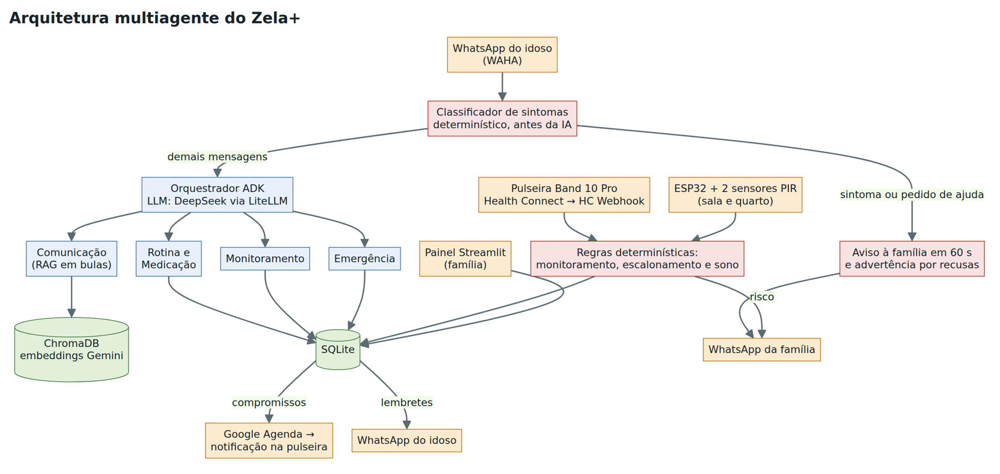
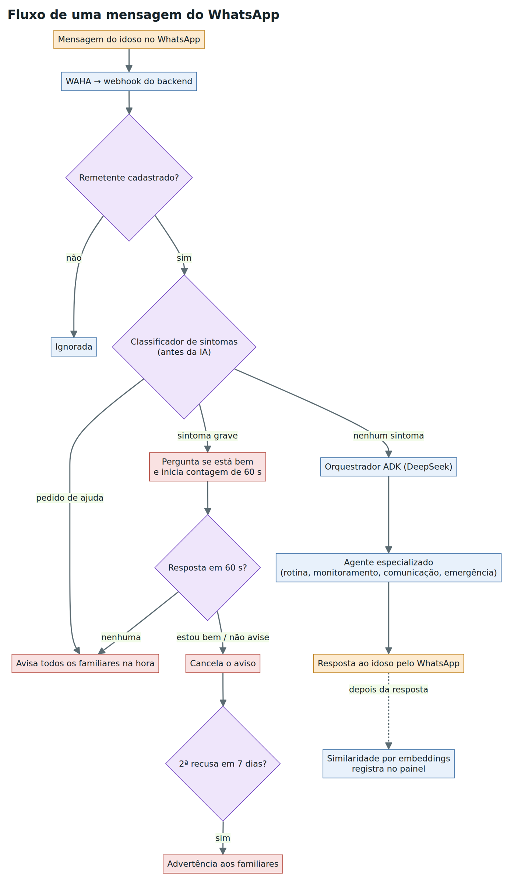
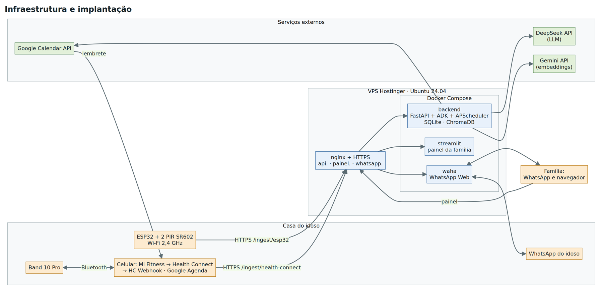
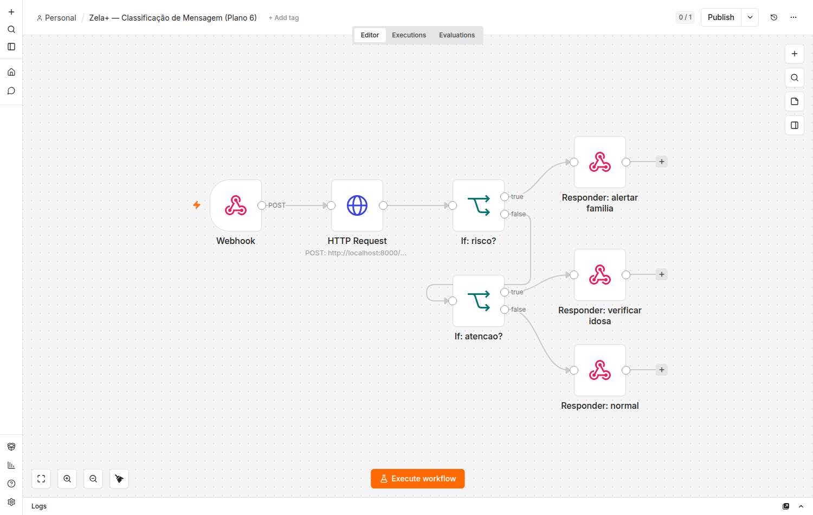
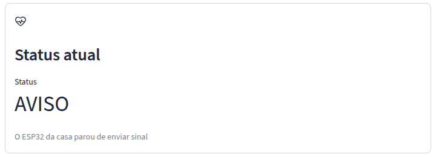
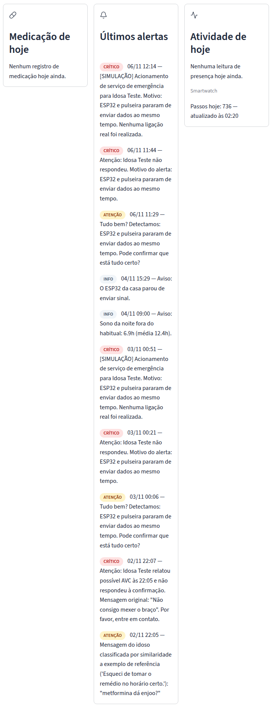
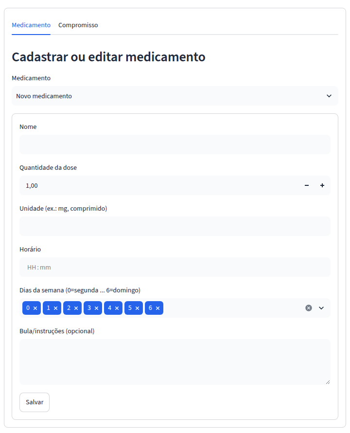
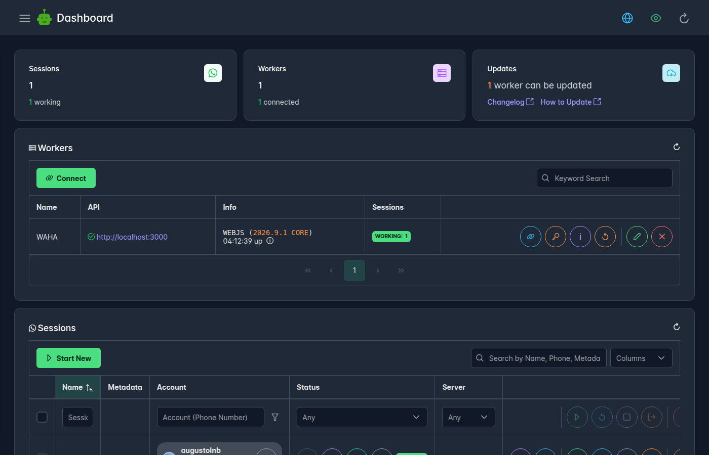
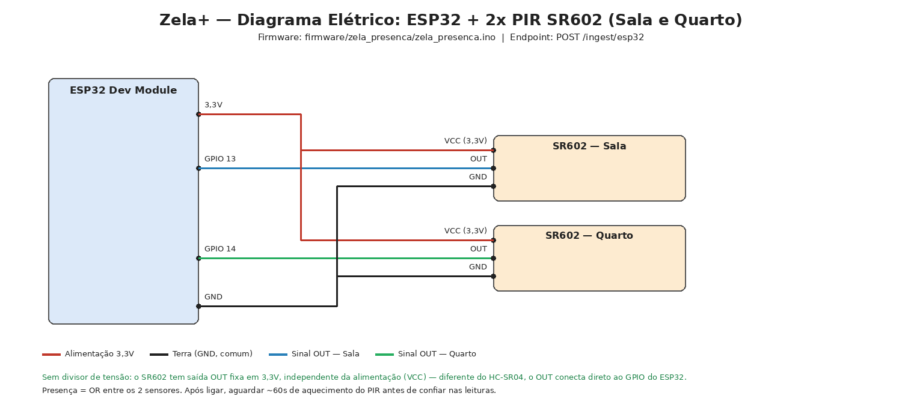

# Zela+ — Relatório do Trabalho Final (Agentes de IA)

**Autor:** Lucas Augusto Nunes de Barros
**Repositório:** https://github.com/augustolnb/ag-zela-
**Vídeo pitch:** roteiro em `docs/pitch/roteiro.md`; o vídeo fica em `docs/pitch/`.

---

## 1. Descrição do projeto

### 1.1 Problema

O projeto nasceu de um caso real: a avó do autor mora sozinha, esquece
consultas, fica em dúvida se tomou um remédio e perde horários de
medicamentos que não são de uso diário. Um smartwatch comum registra dados,
mas não resolve o problema. Três riscos orientaram o projeto:

1. **Esquecimento de medicação e compromissos.** Sem alguém por perto para
   lembrar, doses e consultas são perdidas.
2. **Falta de detecção precoce de risco.** Uma queda, uma ausência longa de
   movimento ou um mal-estar pode passar despercebido por horas.
3. **Família fora do loop.** Parentes que não moram junto não sabem como
   está o dia a dia sem ligar toda hora.

### 1.2 Escopo do MVP

- **Lembretes** de medicamentos por WhatsApp, com confirmação pelo idoso.
  Lembretes de compromissos por WhatsApp e pelo **Google Agenda**, cuja
  notificação o Mi Fitness espelha na pulseira.
- **Monitoramento** com hardware real: pulseira Xiaomi Smart Band 10 Pro
  (passos, sono e frequência cardíaca, via Health Connect) e um ESP32 com
  2 sensores de presença PIR (sala e quarto).
- **Aviso à família em 60 segundos:** um classificador determinístico de
  sintomas, que roda antes da IA, reconhece relatos como "coração acelerado"
  ou "caí". O bot pergunta se está tudo bem e, sem resposta em 60 s, avisa
  todos os familiares.
- **Escada de escalonamento determinística**, nunca decidida por um LLM:
  pergunta ao idoso, avisa a família e, em último caso, simula o contato com
  um serviço de emergência.
- **RAG em bulas:** o bot responde dúvidas sobre 5 medicamentos citando a
  bula e nunca orienta mudança de dose.
- **Painel Streamlit** para a família: status, medicação, alertas,
  atividade e cadastros.
- **Fluxo visual em n8n**, pedido pelo card no lugar do Langflow (seção 3.4).
- **Produção:** tudo roda em uma VPS com HTTPS, usado diariamente pelo autor
  com um perfil de teste.

**Fora do escopo** (trabalho futuro): áudio (STT/TTS) no WhatsApp,
batimentos cardíacos contínuos (seção 6), vários idosos por instalação e
ligação telefônica real.

---

## 2. Arquitetura

O Zela+ usa **5 agentes ADK** (um orquestrador e 4 especializados) cercados
por uma camada de regras determinísticas. A IA conversa, consulta e
explica. Quem decide avisar a família é sempre código determinístico e
testado.



**Decisão de design mais importante:** nenhuma decisão de emergência
depende de um LLM. O aviso em 60 s (`zela/domain/sintomas.py` +
`zela/api/aviso_familia.py`) e a escada de escalonamento
(`zela/domain/emergencia.py`) são código puro, testado com `pytest`. Se a
API do LLM cair, a família continua sendo avisada.

### 2.1 Papel de cada agente

| Agente | Responsabilidade | Ferramentas (tools ADK) |
|---|---|---|
| **Orquestrador** (`orquestrador_zela`) | Direciona cada mensagem ao agente certo | `sub_agents` |
| **Rotina/Medicação** | Lembretes e confirmações de remédios e compromissos | `verificar_lembretes_pendentes`, `confirmar_medicamento` |
| **Monitoramento** | Relata o status já calculado pelas regras | `consultar_status_atual` |
| **Comunicação** | Conversa e responde dúvidas com RAG nas bulas | `consultar_conhecimento` |
| **Emergência/Alertas** | Relata alertas e ocorrências registrados | `consultar_historico_alertas` |

### 2.2 Fluxo de uma mensagem



1. O WAHA entrega a mensagem ao webhook, que só aceita remetentes
   cadastrados (telefone ou LID).
2. O classificador de sintomas roda **antes** da IA:
   - pedido de ajuda: todos os familiares são avisados na hora;
   - sintoma grave: o bot pergunta se está tudo bem e, sem resposta em
     60 s, avisa todos os familiares;
   - "estou bem" ou "não avise" cancelam o aviso. Duas recusas em 7 dias
     geram uma advertência aos familiares.
3. As demais mensagens vão ao orquestrador ADK, que responde pelo agente
   adequado.
4. Depois da resposta, a classificação por similaridade registra no painel
   mensagens que lembram situações de atenção, sem escalar.

Em paralelo, o scheduler (APScheduler) envia lembretes a cada 5 min,
avalia as regras de monitoramento a cada 15 min, verifica o sono às 09:00 e
sincroniza compromissos com o Google Agenda.

### 2.3 Infraestrutura



- **VPS** (Ubuntu 24.04) com nginx e HTTPS em três subdomínios: `api.`
  (backend), `painel.` (Streamlit) e `whatsapp.` (WAHA).
- **Docker Compose** com três serviços: `backend` (FastAPI, ADK,
  APScheduler, SQLite e ChromaDB), `streamlit` e `waha`. Containers no fuso
  `America/Sao_Paulo`.
- **LLM de conversação: DeepSeek** (`deepseek-chat`, via LiteLLM). O Gemini
  gratuito limita a 5 requisições por minuto, pouco para uma conversa real.
  O provedor muda com a variável `ZELA_LLM_PROVEDOR`.
- **Embeddings: Gemini** (`gemini-embedding-2`, 3072 dimensões) na
  classificação por similaridade e na busca semântica do RAG.
- **Endpoints de ingestão** (`/ingest/esp32`, `/ingest/health-connect`) e
  webhook protegidos por token no header `X-Api-Key`.

---

## 3. Detalhamento técnico

### 3.1 Validação de dados com Pydantic (card 3.3)

Todo dado de entrada passa por modelos Pydantic antes da lógica de negócio
(`zela/models/`):

- `perfil.py`: `PerfilIdoso` e `ContatoFamiliar`, com telefone no formato
  E.164, ao menos um familiar e o campo `lid_whatsapp`;
- `rotina.py`: `Medicamento`, `Dosagem`, `Compromisso` (data no futuro na
  criação) e `ConfirmacaoMedicacao`;
- `monitoramento.py`: `LeituraSensor`, `EventoMonitoramento` e os status
  `NORMAL`, `AVISO`, `ATENCAO` e `RISCO`;
- `alertas.py` e `episodio.py`: alertas com status real de entrega
  (`enviado` ou `falhou`) e episódios de sintoma do aviso em 60 s.

### 3.2 Embeddings e RAG (card 3.5)

Os embeddings vêm do Gemini (`zela/embeddings/client.py`) e têm dois usos:

1. **Classificação por similaridade** (`zela/embeddings/classificador.py`):
   a mensagem é comparada por similaridade de cosseno com 18 exemplos
   rotulados (`exemplos_referencia.py`) e recebe o rótulo do mais próximo.
   Em produção, essa classificação gerou alarmes falsos. Hoje ela só
   registra no painel. A detecção de sintomas que avisa a família é
   determinística (seção 2.2).
2. **RAG em bulas:** 5 bulas (dipirona, losartana, metformina, sinvastatina
   e dapagliflozina) em `zela/conhecimento/bulas/`, divididas em trechos de
   até 1.500 caracteres e indexadas no ChromaDB (97 trechos em produção). A
   reindexação é incremental, por hash, e roda em segundo plano. O agente de
   Comunicação responde só com base nos trechos encontrados, cita a bula e
   nunca orienta mudança de dose.

### 3.3 Orquestração multiagente com ADK (card 3.6)

`zela/agents/orchestrator.py` define os 5 agentes da seção 2.1 como
`google.adk.agents.Agent`. O orquestrador registra os 4 especializados como
`sub_agents`, e o ADK roteia a partir da `instruction` de cada um. As
ferramentas são funções Python que consultam a camada de domínio. O
comportamento pode ser verificado com `adk run zela/agents`.

O modelo vem de `_montar_modelo_padrao()`: `ZELA_LLM_PROVEDOR=deepseek` usa
`LiteLlm(model="deepseek/deepseek-chat")`, e o padrão usa o Gemini. As
versões de `google-adk`, `litellm` e `mcp` estão fixas no `pyproject.toml`,
porque um build sem versões fixas derrubou o bot em produção (seção 4).

### 3.4 Workflow n8n (card 3.4/3.8)

O card cita o Langflow, mas o curso migrou para o n8n, então o fluxo visual
foi feito em n8n (`docs/n8n/zela-classificacao-mensagem.json`). Um nó
Webhook recebe a mensagem, um nó HTTP Request chama
`POST /api/classificar-mensagem` no backend, e dois nós `If` roteiam o
resultado para três respostas. É uma demonstração visual da classificação;
a integração real com o WhatsApp é feita pelo WAHA.



### 3.5 Painel Streamlit (card 3.7)

O painel (`zela/streamlit_app/`) mostra status atual, medicação do dia,
últimos alertas, atividade do dia (presença do ESP32 e passos da pulseira)
e formulários de medicamentos e compromissos. O acesso é protegido por
senha (`STREAMLIT_SENHA`). As capturas abaixo são da produção em 11/11/2026,
com o ESP32 desligado, o que o próprio painel aponta.







### 3.6 Comunicação via WhatsApp (card 3.8)

O WAHA (WhatsApp HTTP API, self-hosted) mantém a sessão do WhatsApp Web. O
webhook (`zela/api/webhook.py`) recebe as mensagens, e o `WahaClient`
(`zela/integrations/waha_client.py`) envia as respostas. Contas com LID
recebem mensagens pelo `chatId` resolvido com `check-exists`.



### 3.7 Hardware: ESP32 e pulseira

**ESP32 com 2 sensores PIR SR602** (sala e quarto), alimentados em 3,3 V,
com saída direto no GPIO 13 e no GPIO 14. A cada mudança de presença e a
cada 5 minutos (sinal de vida), a placa envia um POST HTTPS a
`/ingest/esp32`. O HC-SR505 fica como trabalho futuro. Detalhes em
`docs/hardware/automacao_esp32.md`.



**Pulseira:** Band 10 Pro → Mi Fitness → Health Connect → HC Webhook
(instalado gratuitamente pelo Obtainium) → `/ingest/health-connect`.

**Regras de monitoramento** (`zela/domain/monitoramento.py`, a cada 15 min):

| Situação | Resultado |
|---|---|
| ESP32 e pulseira sem dados (ESP32 há 15 min, pulseira há 6 h) | RISCO → escada de escalonamento |
| ESP32 ativo e nenhum movimento há 8 h | RISCO → escada de escalonamento |
| Frequência cardíaca fora da faixa plausível | ATENÇÃO |
| Só uma das fontes sem dados | AVISO à família, sem escada |
| Sono 30% acima ou abaixo da média de até 14 noites | Aviso de tendência às 09:00 |

A escada pergunta ao idoso, avisa a família depois de 10 min sem resposta e
simula o contato de emergência 15 min depois.

---

## 4. Dificuldades e problemas reais encontrados

A suíte automatizada não pega problemas de integração com sistemas reais.
Estes apareceram em uso real e estão detalhados no relatório de erros do
autor:

| Problema | Causa | Correção |
|---|---|---|
| Modelos `gemini-2.0-flash` e `text-embedding-004` com 404 | Modelos descontinuados | `gemini-3.8-flash` e `gemini-embedding-2` |
| Mensagens do WhatsApp sem resposta | Remetente chega como LID, sem telefone | Campo `lid_whatsapp` e LID aceito no webhook |
| 401 no envio pelo WAHA | Chave aleatória a cada restart e um container antigo | `WAHA_API_KEY` fixa no `.env` |
| "No LID for user" ao avisar a família | Envio por `<telefone>@c.us` em conta com LID | `chatId` resolvido com `check-exists`; status real de entrega |
| Bot pedia confirmação e nunca avisava a família | Risco dependia da IA e de uma escada lenta | Classificador determinístico e aviso em 60 s |
| Bot fora do ar com erro 500 após deploy | Dependências sem versão fixa | Versões fixas; falha da IA vira mensagem, não 500 |
| Gemini lento em conversa | Limite de 5 requisições/min no tier gratuito | DeepSeek para conversa |
| Alarmes falsos de similaridade | Vizinho mais próximo sem piso de confiança | Similaridade só registra no painel |
| Leituras duplicadas (4.832 → 853) | HC Webhook reenvia 48 h a cada sincronização | Índice único e `INSERT OR IGNORE` |
| Envio do celular recusado (413) | Lote de 1,92 MB, acima do limite do nginx | `client_max_body_size 10m` |
| Payload do Health Connect diferente da documentação | Formato real em listas por tipo e timestamps com fuso | Ingestão reescrita para o formato real |
| Batimentos só chegam em treinos | Mi Fitness só compartilha batimentos de treino com o Health Connect | Limitação documentada; Gadgetbridge como alternativa |
| Aviso falso "pulseira parou" | Regra olhava só batimentos, com limite de 30 min | Qualquer dado da pulseira conta; limite de 6 h |
| Aviso de sono com média de 12,4 h | Versões da mesma noite somadas | Sessões agrupadas pelo início |
| Painel sem presença | Firmware apontava para o IP local | ESP32 apontado para o domínio de produção |
| ESP32-S3 reiniciando no boot | Provável oxidação na placa | Troca por placas ESP32 DevKit novas |
| Bulário da Anvisa recusou as buscas (403) | Bloqueio do site | Cópias de fabricantes, com fonte registrada |

---

## 5. Resultados obtidos

- **432 testes automatizados** passando (`pytest -q`), cobrindo modelos,
  domínio, armazenamento, API, scheduler, embeddings, agentes ADK e painel.
- **Em produção desde 02/11/2026**, com mensagens reais de WhatsApp, a
  pulseira enviando passos e sono e o ESP32 enviando presença.
- **Aviso à família validado em produção (02/11):** "preciso de ajuda"
  avisou o familiar no mesmo segundo (10:33:48). "Não consigo mexer o braço"
  foi classificada como possível AVC às 22:05:58 e, sem resposta, o familiar
  foi avisado às 22:07:02, 64 s depois, dentro da tolerância do job de 10 s.
- **RAG:** as 5 bulas estão indexadas em produção. Perguntado sobre o
  paracetamol, que não está na base, o bot não encontrou a bula e não
  inventou a resposta.
- **Monitoramento:** com o ESP32 desligado e o celular sem sincronizar por
  mais de 6 h, a escada chegou à simulação de emergência, como as regras
  determinam.

| Fase | Entregável | Status |
|---|---|---|
| Fundação | Modelos Pydantic, domínio dos 5 agentes, esqueleto ADK | Completo |
| Comunicação real | WhatsApp via WAHA | Completo |
| Sensores | Band 10 Pro via Health Connect e ESP32 com 2 PIR | Completo |
| Embeddings | Similaridade e RAG em bulas | Completo |
| Painel | Streamlit da família | Completo |
| Workflow | n8n (substitui o Langflow) | Completo |
| Produção | VPS, aviso em 60 s, Google Agenda na pulseira | Completo |
| Empacotamento | Relatório, README e vídeo pitch | Em andamento |

---

## 6. Limitações conhecidas e trabalhos futuros

1. **Batimentos contínuos:** o Mi Fitness só compartilha os batimentos de
   treino com o Health Connect. Testar o Gadgetbridge ou ler a transmissão
   BLE da pulseira são os próximos passos.
2. **Sincronização prova atividade, não uso:** a regra da pulseira mostra
   que o celular sincroniza, não que a pulseira está no pulso. Com o ESP32
   parado, uma demora de mais de 6 h do celular gera uma escalada.
3. **Lista de sintomas:** formas de dizer um sintoma que o classificador não
   conhece só chegam ao painel.
4. **Um idoso por instalação**, com o perfil de teste em produção.
5. **Sem áudio** no WhatsApp e **sem ligação real** para emergência
   (simulada).
6. **Bulas:** versões obtidas de fabricantes e farmácias; precisam ser
   conferidas no Bulário da Anvisa.

---

## 7. Instruções de uso

```bash
git clone https://github.com/augustolnb/ag-zela-.git && cd ag-zela-
python -m venv .venv && source .venv/bin/activate
pip install -e ".[dev,deepseek]"
pytest -q                                   # 432 testes
uvicorn zela.api.main:app --reload          # backend: webhook, API e scheduler
streamlit run zela/streamlit_app/app.py     # painel da família
```

Em produção, `docker compose up -d --build` sobe os três serviços. O
`README.md` explica as variáveis de ambiente, o WAHA, a pulseira, o ESP32,
o Google Agenda, o n8n e o deploy na VPS.

---

## 8. Vídeo pitch

Roteiro em `docs/pitch/roteiro.md`. O vídeo fica em `docs/pitch/`.
